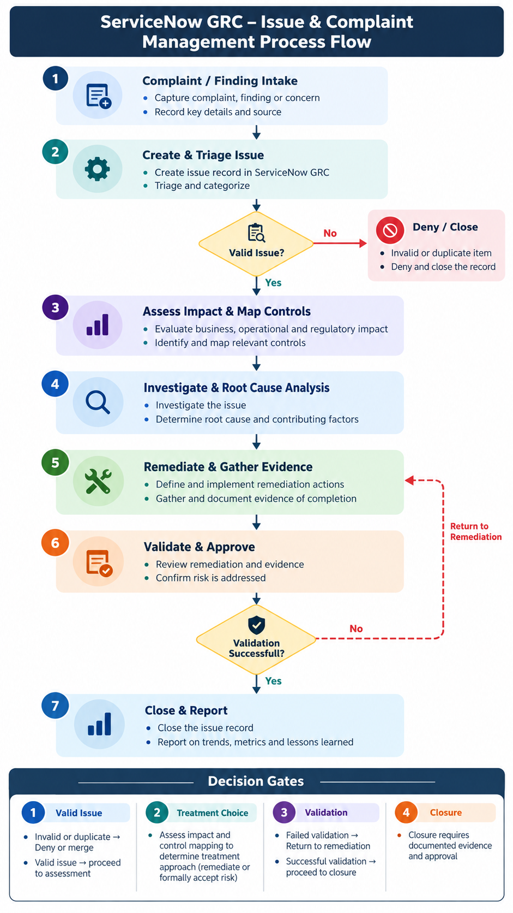
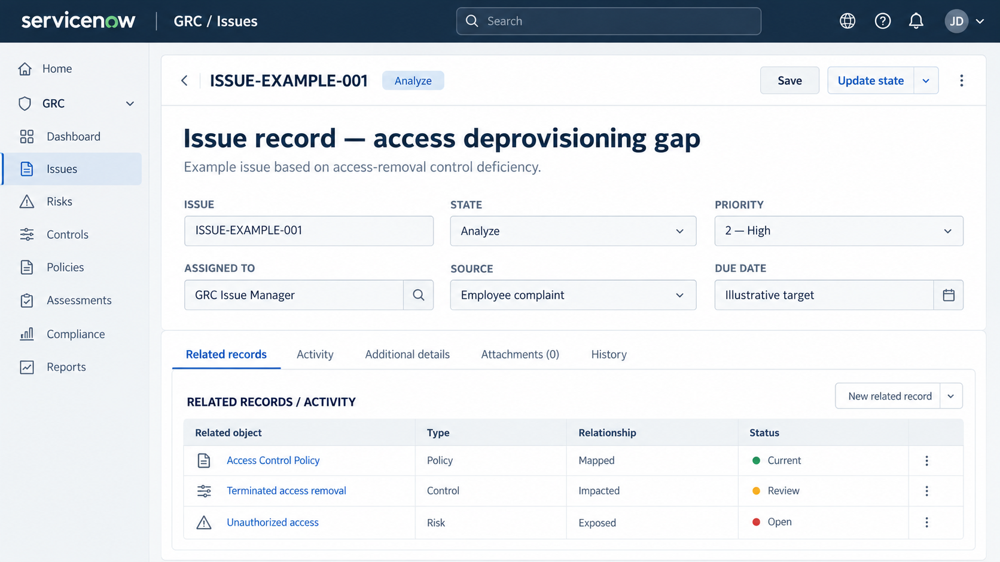
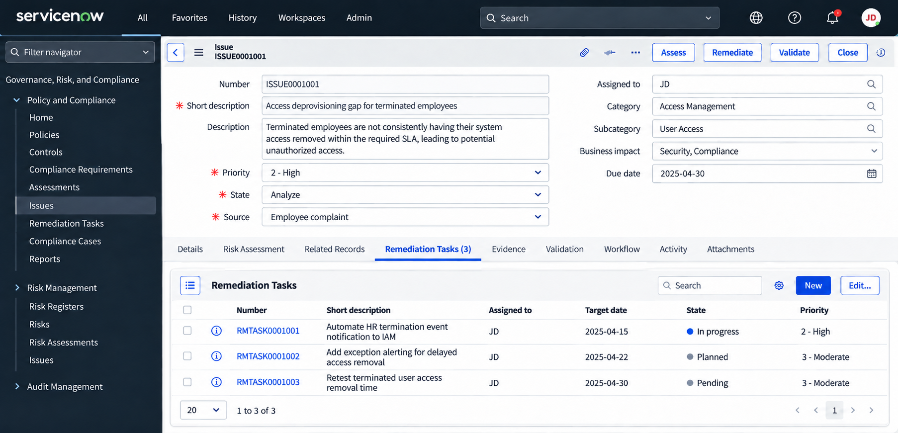
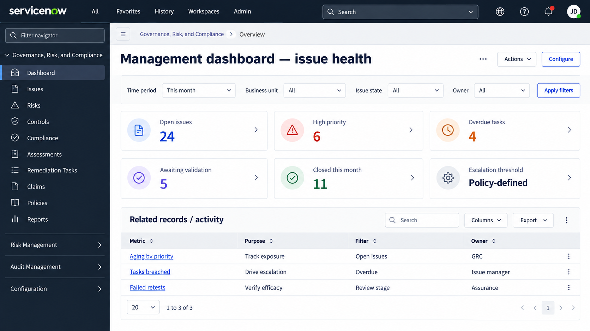

# ServiceNow Governance, Risk & Compliance (GRC) Project Documentation

## Executive summary

This sample project defines a controlled process to intake complaints and compliance findings, assess exposure, assign accountable owners, implement corrective actions, collect evidence, validate effectiveness, and approve closure. It is industry-neutral and suitable for portfolio, training, and implementation-planning use.

> **Scope note:** “Complaint” is an intake source in this design, not an assertion that ServiceNow ships an identical out-of-the-box complaint module. Portal forms, integrations, states, approvals, and dashboards are configurable and may require licensed GRC capabilities.

## Objectives and scope

- Create a single record of truth for issues originating from employees, audits, control tests, risk assessments, or monitoring.
- Apply consistent ownership, severity, prioritization, due dates, follow-up, and escalation.
- Associate findings with applicable policies, risks, controls, entities, and obligations.
- Ensure remediation is supported by testable evidence and independent validation.
- Maintain an audit trail of decisions, exceptions, approvals, and final dispositions.

## End-to-end workflow

### Workflow steps and deliverables

| Stage | Accountable role | Key activity | Output |
|---|---|---|---|
| 1. Intake | Reporter / employee | Complaint, audit finding, or control alert | Submission ID and source |
| 2. Triage | GRC analyst | Validate, deduplicate, assign owner | Accepted issue or documented disposition |
| 3. Risk assessment | Risk / issue owner | Assess likelihood, impact, and urgency | Rating, priority, and due date |
| 4. Mapping | Compliance / control owner | Link obligations, controls, risks, and business entities | Traceability to related records |
| 5. Investigation / RCA | Issue owner + SMEs | Evidence review and 5 Whys / cause analysis | RCA and causal factors |
| 6. Remediation | Action owners | Corrective plan, tasks, dates, and dependencies | Completed actions and artifacts |
| 7. Validation | Independent tester | Sample-based retesting and effectiveness evaluation | Pass/fail validation report |
| 8. Approval / closure | Issue manager / approver | Check closure criteria and sign off | Approved disposition and audit trail |

## Proposed ownership and access model

- **Reporter:** Raise a complaint and receive status updates under agreed visibility rules.
- **GRC analyst:** Triage and classify.
- **Issue manager:** Manage lifecycle, rating, and escalation.
- **Control / risk owner:** Assess linked exposure.
- **Remediation owner:** Perform corrective action.
- **Validator:** Verify efficacy independently of implementation.
- **Approver:** Authorize closure or a documented exception.
- **Administrator:** Configure roles, ACLs, flows, and reports.

**Security design:** Apply least privilege, record-level access controls, confidentiality where appropriate, and separation of remediation, validation, and approval duties.

## Data model and important fields

- **Issue:** ID, title, description, source, issue type, classification, priority/rating, impacted entity, owner, due date, state, RCA, and treatment decision.
- **Relationships:** Policy statement, control, risk, audit observation, compliance requirement, business process, and linked issue(s).
- **Remediation task:** Parent issue, owner/group, action, priority, planned/actual dates, state, evidence, and work notes.
- **Validation:** Test plan, sample, criteria, test outcomes, residual risk, reviewer, timestamps, and final approval.

## Screenshots and proposed UI touchpoints

The images below are purpose-built illustrative mockups, not screenshots from a live ServiceNow tenant. Replace them with screenshots from your own licensed instance after implementation, and redact personal or confidential data.

## Automation requirements (illustrative)

- On valid intake, create or route an issue to a triage queue and assign a unique record identifier.
- On classification or rating, calculate the target date and notify the assigned owner according to configured rules.
- On an overdue task, notify the task owner, escalate to the issue manager, and flag the dashboard.
- Before closure, require all mandatory actions, evidence, validation results, and approval.
- On failed retest, reopen remediation, record the discrepancy, and reschedule validation.
- On exception or risk acceptance, route to an authorized risk approver, record the rationale, and set a review expiry.

## Sample case: terminated-user access

**Scenario:** An employee reports that access for a terminated colleague remained active after the required deprovisioning window. Triage confirms a potentially valid control failure; the issue manager rates it High based on exposed systems and duration.

- **Related policy:** Identity & Access Management / Access Control Policy.
- **Risk:** Unauthorized access from delayed deprovisioning.
- **Control objective:** Disable terminated-user access within the defined organizational SLA.
- **Root cause:** HR termination events were not reliably propagated to IAM, and there was no exception alerting.
- **Remediation:** Automate HR-to-IAM notifications, add alerts, and establish fallback ownership.
- **Evidence:** Event logs, workflow configuration, ticket history, alert samples, and test results.
- **Validation:** Compare termination effective times with access-removal timestamps for a defined sample.
- **Closure decision:** Close only if acceptance criteria pass and the delegated approver signs off.

## Acceptance and closure criteria

- Issue classification, owner, linked records, and RCA are complete.
- All required remediation tasks are completed with traceable evidence.
- The control tester documents the sampling method and effectiveness result.
- Residual exposure is within tolerance or an authorized exception is approved.
- Closure approval, dates, work notes, and attachments are retained.

## Reporting KPIs

Suggested widgets include new issues by intake source; open issues by severity and business unit; average days to triage; issue aging buckets; due-date/SLA breach rate; overdue remediation tasks; repeat findings; pass/fail retest rate; accepted risks approaching expiry; and mean time to closure. Segment by owner, process, and impacted control.

## Functional test scenarios

- **TC01:** Valid complaint intake creates or routes an issue with a reporter reference.
- **TC02:** A duplicate finding is linked or merged without losing audit history.
- **TC03:** A high-impact or urgent issue receives the defined escalation and due date.
- **TC04:** An unauthorized user cannot see a confidential issue or evidence.
- **TC05:** Closed remediation cannot bypass required validation evidence.
- **TC06:** Failed validation sends the case back for corrective action.
- **TC07:** Approval by an unauthorized role is blocked.
- **TC08:** Dashboard filters reconcile to underlying issue and task counts.

## Implementation checklist

Confirm licensed products and workspace; define intake channels; finalize taxonomy and assessment scales; configure the role/ACL matrix; build routing and notifications; define SLA policy; enable relationships and task templates; configure the validation gate and exception path; create reports; execute UAT; capture actual instance screenshots; publish the SOP; and train owners.

## Assumptions and limitations

This is a solution blueprint, not evidence of a deployed implementation. Exact form labels, state model, navigation paths, entitlements, automatic SLA notifications, and integration capabilities depend on the ServiceNow release and installed applications. Risk acceptance is a distinct documented outcome and should not be represented as successful remediation.
